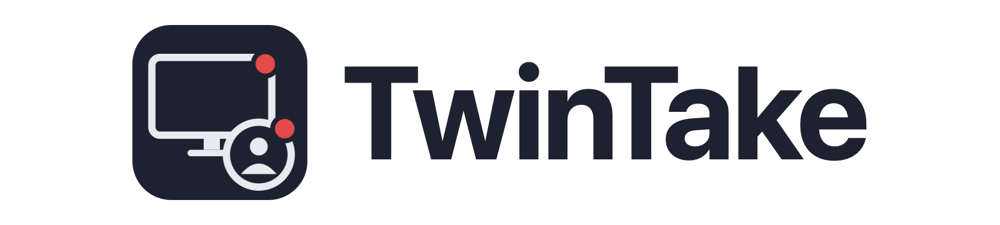
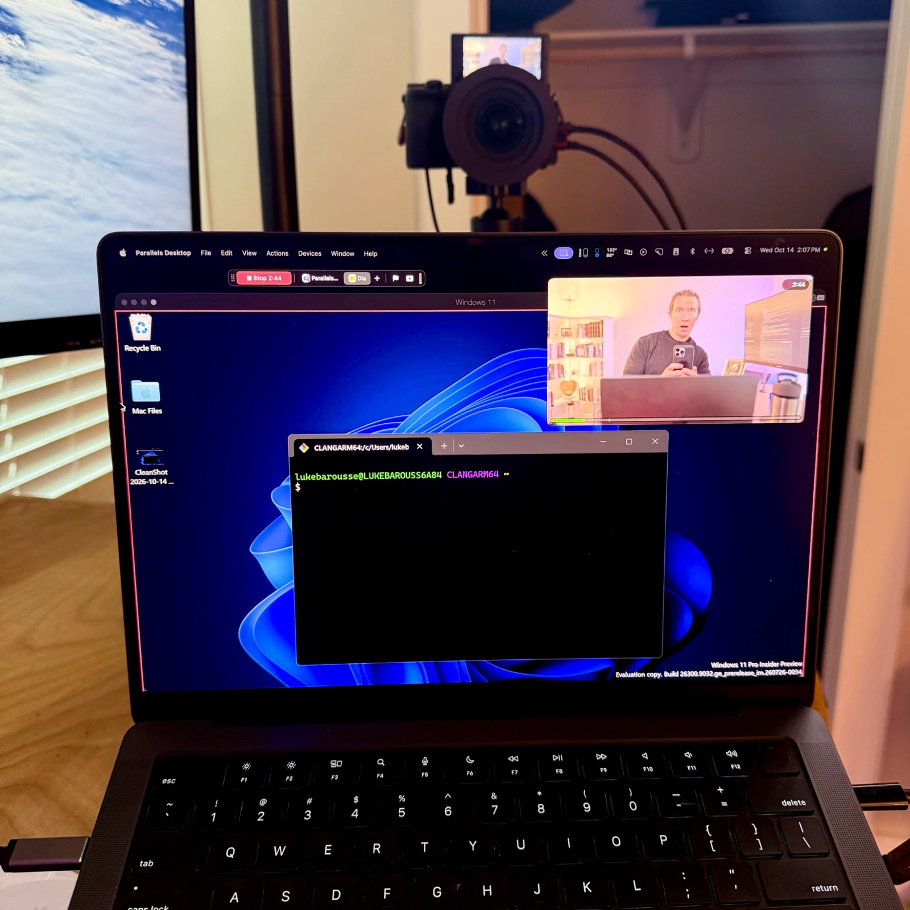

<p align="center">
  <picture>
    <source media="(prefers-color-scheme: dark)" srcset="docs/images/banner-dark.png">
    
  </picture>
</p>

<p align="center"><strong>Record your camera and your screen at the same time, into two separate files, on macOS.</strong></p>

<p align="center"></p>

TwinTake is a native menu-bar app. Each take is one folder with `camera.mov`, `screen.mov` and a few small metadata files. Edit the files in any editor that reads `.mov`: Final Cut Pro, Premiere Pro, DaVinci Resolve, ScreenFlow and others.

Status: early development. TwinTake is built for one creator's desk setup. Support is not promised.

## Features

- **Two files, one start.** camera.mov and screen.mov begin within one camera frame of each other.
- **Files for any editor.** HEVC video (or H.264, or ProRes 422 LT) and uncompressed 48 kHz 24-bit PCM audio. Each audio source has its own track. TwinTake never mixes them.
- **Exact frame rates.** camera.mov follows the camera's signal, for example 4K at 23.976 fps. screen.mov records at twice that rate (47.952 fps). Both files have a constant frame rate.
- **A fixed 16:9 screen frame.** TwinTake snaps your app's window into the frame and dims the rest of the display. Parallels Desktop keeps its toolbar outside the frame.
- **Control bar and camera window.** Start and stop, switch apps, flag a mistake, and watch yourself. Neither window is in the recording, and neither takes the focus from your app.
- **Replay while recording.** Review the take so far, with Skip silence and Flags only, while the take goes on.
- **Keystrokes on screen.** The shortcuts you press (⇧⌘P, or Ctrl+Shift+P in a Parallels VM) show in a pill at the bottom of the frame and in screen.mov. Typed text never shows. Shortcuts other apps own (CleanShot X's ⇧⌘4) show too.
- **Mic and camera checks.** Live meters. Warnings when the camera records with its built-in mic or does not hear you. Checks for a capture card on USB 2, for empty frames, and for a camera that sends the same picture again (a choppy camera.mov).
- **Crash-safe sessions.** Both files get a movie fragment every 2 s, so a crash keeps everything up to the last fragment. The session folder format is documented for editing tools.

<p align="center">
  <picture>
    <source media="(prefers-color-scheme: dark)" srcset="docs/images/menu-dark.png">
    
  </picture>
</p>
<p align="center"></p>

## Requirements

- macOS 15 (Sequoia) or later. TwinTake is macOS only. It is tested on Apple silicon.
- Swift 6 to build: Xcode 16 or later, or its Command Line Tools.
- For camera.mov: any camera that macOS sees. TwinTake is tested with a Sony a6600 over clean HDMI and an Elgato Cam Link 4K on USB 3. Screen mode needs no camera.

## Build from source

```bash
git clone https://github.com/lukebarousse/twintake.git
cd twintake
scripts/install.sh              # release build, installed in /Applications and opened
scripts/build-app.sh            # debug build: build/TwinTake.app
swift test                      # unit tests
```

Run `scripts/install.sh` again after you pull changes: it rebuilds, replaces the app in /Applications (it refuses while a take is recording) and keeps your permissions.

Add your Apple ID in Xcode > Settings > Accounts. Then create a free Apple Development certificate (Manage Certificates > + > Apple Development). The build script signs with it, so macOS keeps the permissions between builds. See [Signing](docs/setup.md#signing-for-builders).

## Quick start

1. Open `build/TwinTake.app`. It lives in the menu bar (a record icon), not in the Dock.
2. Click the icon. Under **Permissions**, allow Camera, Microphone, Screen Recording and Accessibility. Quit and reopen TwinTake after you allow Screen Recording.
3. Pick **Camera**, **Screen** or **Both**. Under Camera, check the **Signal** line, for example "4K · 3840×2160 · 23.976 fps".
4. Fix each red item in the menu. Red items block Start. Orange items are warnings.
5. Click **Record** on the control bar, or press ⌃⌥⌘R. Click **Stop** to end the take. The take is in `~/Movies/TwinTake`.

## Documentation

| Page | What it covers |
|---|---|
| [User guide](docs/guide.md) | Every feature: modes, devices, camera window, screen frame, control bar, Flag, Replay, keystrokes, mic checks, settings, shortcuts |
| [Setup](docs/setup.md) | Camera HDMI settings, capture card, HDMI splitters, display refresh rate, permissions, signing |
| [Troubleshooting](docs/troubleshooting.md) | Green preview, 1080p signal, mic warnings, menu bar indicators, crashes and logs |
| [Session folder format](docs/SCHEMA.md) | camera.mov, screen.mov, session.json, events.jsonl and voice.jsonl, field by field |
| [Device tests](docs/TESTING.md) | The checks that need real devices |

All pages: [docs/README.md](docs/README.md).

## License and credits

MIT. See [LICENSE](LICENSE).

Some files adapt code from two other MIT projects: [BetterCapture](https://github.com/jsattler/BetterCapture) by Joshua Sattler and [Rectangle](https://github.com/rxhanson/Rectangle) by Ryan Hanson. [NOTICE.md](NOTICE.md) lists the files and reproduces both licenses.
