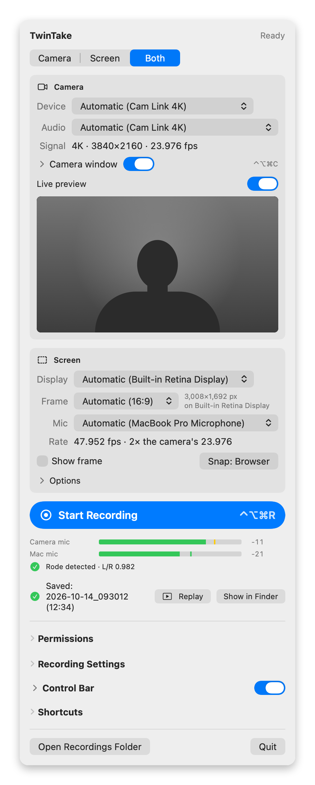
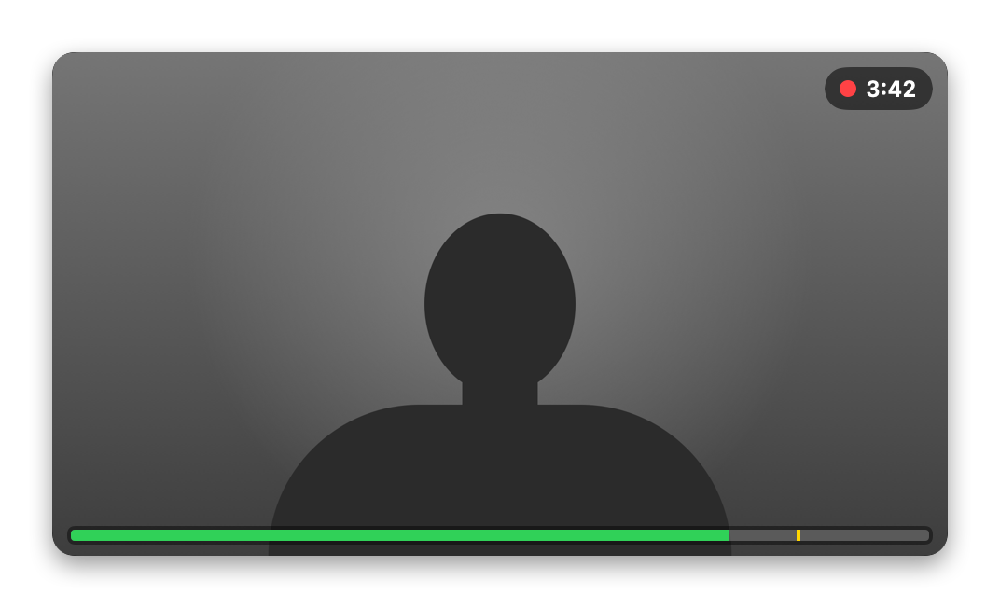
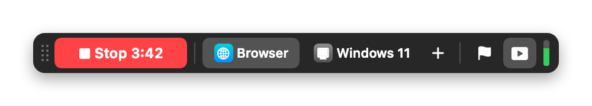
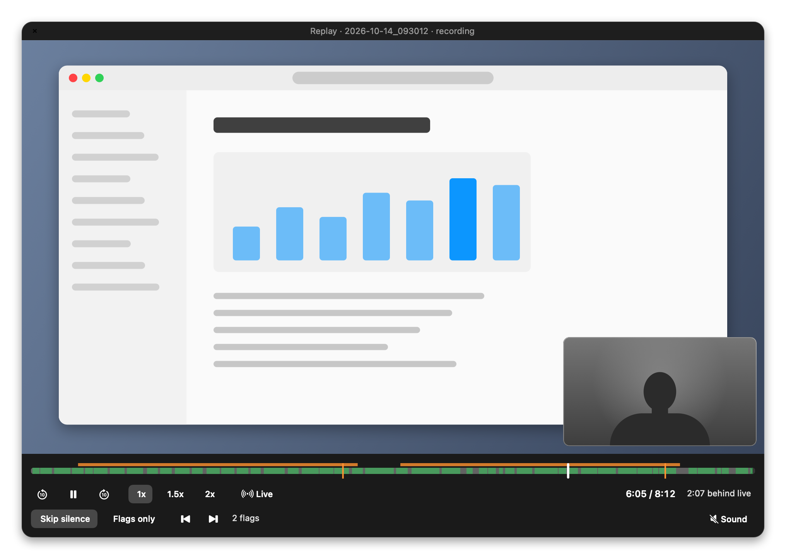
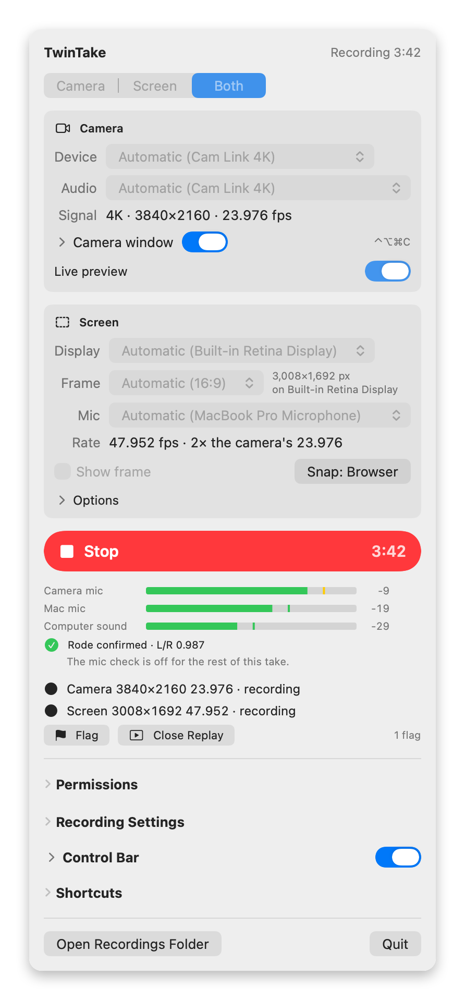

# User guide

This guide covers every part of TwinTake. For the hardware and the first setup, see [setup.md](setup.md). For problems, see [troubleshooting.md](troubleshooting.md).

- [The menu](#the-menu)
- [Modes](#modes)
- [Devices and the Signal line](#devices-and-the-signal-line)
- [Camera window](#camera-window)
- [Level meters](#level-meters)
- [Screen frame and snapping](#screen-frame-and-snapping)
- [Parallels Desktop](#parallels-desktop)
- [Control bar](#control-bar)
- [Flag](#flag)
- [Replay](#replay)
- [Keystrokes](#keystrokes)
- [Mic check and the mic warning](#mic-check-and-the-mic-warning)
- [Settings](#settings)
- [Shortcuts](#shortcuts)
- [Start, Stop and what happens during a take](#start-stop-and-what-happens-during-a-take)
- [The session folder](#the-session-folder)

## The menu

<p align="center">
  <picture>
    <source media="(prefers-color-scheme: dark)" srcset="images/menu-dark.png">
    
  </picture>
</p>

TwinTake lives in the menu bar. Click its record icon to open the menu. From top to bottom:

- **Header:** "Ready", "Not ready", "Recording 12:34" or "Saving…".
- **Banners:** camera mic warnings and camera trouble (USB 2, empty frames).
- **Mode:** Camera, Screen or Both.
- **Camera** and **Screen** sections, for the modes that use them.
- **Issues:** a red item blocks Start. An orange item is a warning.
- **Start Recording** (Stop while recording), the level meters, and status lines: the tracks, Flag and Replay, notices, and the last take ("Saved: 2026-10-12_174000 (12:34)").
- **Permissions**, **Recording Settings**, **Control Bar**, **Keystrokes** and **Shortcuts**.
- **Open Recordings Folder** and **Quit**.

The menu stays attached under the menu bar when its height changes. It scrolls when it is taller than the display.

The menu bar icon shows the state:

- A record symbol: idle.
- An orange record symbol: idle, and something needs you (camera trouble or a mic warning).
- A red dot and the elapsed time: recording.
- An orange dot and the elapsed time: recording, and something needs you. A beep comes with it. Open the menu to see what.

## Modes

| Mode | Files | Audio tracks |
|---|---|---|
| Camera | camera.mov | A1: the camera mic |
| Screen | screen.mov | A1: the Mac mic. A2: the computer sound (when Record computer sound is on) |
| Both | camera.mov and screen.mov | All of the above |

In Camera mode, TwinTake still opens the Mac mic during a take. It meters it and does not record it. The mic warning needs it (see [Mic check and the mic warning](#mic-check-and-the-mic-warning)).

You can change the mode only while nothing records.

## Devices and the Signal line

**Camera section:**

- **Device:** the camera. Automatic picks a camera with "Cam Link" in its name, else the first external camera.
- **Audio:** the camera audio for camera.mov. Automatic picks the camera's own audio input (for a Cam Link: its HDMI audio). "No audio" records camera.mov without an audio track.
- **Signal:** read-only. It shows what camera.mov records, for example "4K · 3840×2160 · 23.976 fps".

camera.mov records exactly what the camera sends. TwinTake has no size or rate setting: you set them on the camera. If a capture card gets less than 4K, the Signal line is orange and a fix shows under it. See [setup.md](setup.md#camera-hdmi-output).

Change the camera's size or rate only while nothing records. camera.mov keeps the size and the frame grid it started with. A change during a take (also 24p to 30p at the same size) turns the icon orange. Stop, then start again.

**Screen section:**

- **Display:** the display to record. Automatic is the built-in display when it is on, else the main display.
- **Frame:** the part of the display to record. See [Screen frame and snapping](#screen-frame-and-snapping).
- **Mic:** the Mac mic for screen.mov A1. Automatic is the built-in "MacBook Pro Microphone", never the system default input. "No mic" records no mic track.
- **Rate:** read-only. The screen records at 2× the camera rate, up to a camera rate of 30 fps. For a 23.976 camera, the screen records at 47.952 fps, so a 23.976 timeline uses every other screen frame. In Screen mode the rate follows the last camera rate TwinTake saw (47.952 until it saw a camera).

**A device on a new USB port:** macOS gives the device a new ID. TwinTake finds it again by its name and model, and says so ("Cam Link 4K moved to a new USB port; reconnected."). It never switches to a second device with the same name that it saw next to yours. It rematches an audio input only when it is a USB device of the same maker and product, never a Bluetooth or built-in input. If two new devices have the name, pick one in the menu.

## Camera window

<p align="center">
  
</p>

A small floating window shows your camera, so you can watch yourself while you talk. The window is never recorded: screen.mov shows what is under it.

1. Turn on **Camera window** under Camera, or press ⌃⌥⌘C.
2. Drag the window to move it. Drag near an edge or a corner to resize it. It keeps the 16:9 shape and is at least 240×135.
3. Right-click it for **Mirror**, **Size** (Small 320×180, Medium 480×270, Large 640×360), **Mic Check**, **Reconnect Camera** and **Hide**. A close button shows when the pointer is over the window.

The arrow next to the Camera window switch shows three options:

- **Mirror** (on by default): the picture is mirrored like a webcam. camera.mov is never mirrored.
- **Keep the camera window on while recording** (on by default). Off: the window hides at Start and comes back after Stop. During the take, ⌃⌥⌘C does not show it.
- **Live picture while recording** (on by default). A small 640×360 preview output stays in the camera session next to the full-size recording. If a take drops camera frames, turn it off: the window then shows only the timer. It applies at the next Start.

More about the window:

- While recording, the window shows a red dot and the elapsed time.
- It first opens on a display that does not hold the recording frame. Then it remembers its place and size on each display.
- A click on the window does not take the focus from your app. ⌃⌥⌘F still snaps your app's window.
- It sits just above the dim around the frame, so it is never dimmed. Other apps' menus and popovers open over it.
- A window turned on during a take has no live picture: the preview output is kept only when the window is on at Start.
- If the camera sends no picture, the window opens the camera again a few times. Then it shows "No picture from the camera". Open the menu, or hide and show the window, to try again.

**Live preview** (the switch right above the preview picture in the menu) shows the camera in the menu while the menu is open. The menu shows the picture only while nothing records. During a take, use the camera window.

**When the camera is open:** TwinTake opens the camera only while something shows it: the camera window, the open menu with Live preview on, or a take. Then the camera stays open between takes, so Start is quick. When nothing shows the camera any more, the camera and the mics close about 1.5 s later. When the display sleeps, the screen locks or you switch users, they close at once, and they open again when you come back. An open camera uses more power. For the macOS camera and mic indicators, see [troubleshooting.md](troubleshooting.md#menu-bar-indicators).

## Level meters

- **Before recording:** while the camera preview is on (the camera window or the menu's Live preview), two meters show under Start Recording: **Camera mic** (the camera audio) and **Mac mic**.
- **While recording:** three meters show under Stop: **Camera mic** (camera.mov A1), **Mac mic** (screen.mov A1) and **Computer sound** (screen.mov A2). Computer sound has a meter only while recording, because it needs the screen stream.
- **Camera window:** a bar along the bottom edge shows the camera mic.
- **Control bar:** a thin vertical meter shows the Mac mic.

The bar is green, yellow above -12 dBFS and red above -3 dBFS. The tick is the peak of the last 1.5 s, and the number next to the bar is that peak. **CLIP** means samples at or above -1 dBFS: while recording, at any time since Start; before recording, in the last 1.5 s. The meters update about 20 times a second, only while the menu, the camera window or the control bar shows a meter.

## Screen frame and snapping

**Frame** (Screen section):

- **16:9 frame:** 1504×846 pt, centered left to right. **Frame position** puts it at the bottom or the top (see below). On a 14" MacBook Pro that is 3,008×1,692 px. On a smaller display it shrinks to fit.
- **Whole display:** the full display. It is exact 16:9 on a 16:9 monitor.
- **Automatic:** the whole display on a 16:9 display, else the 16:9 frame.

The size in pixels shows next to the Frame picker.

**Show frame** draws the frame on the display while nothing records. During a take in Screen or Both mode, TwinTake always shows the frame.

**Options** (the arrow under Screen):

- **Frame position:** **Bottom** puts the 16:9 frame flush with the bottom of the display. **Top** puts it under the menu bar. The default is Bottom on the built-in display and Top on other displays. TwinTake remembers the pick for each display. See [setup.md](setup.md#frame-position).
- **Record computer sound** (on by default): sound from videos and apps, on its own track (screen.mov A2). TwinTake's own sound is never in it.
- **Snap the front window into the frame on Start** (on by default).
- **Hide other windows** (off by default): records only the snapped app. Menus it opens may be missing. With keystrokes in screen.mov, TwinTake records the frame region with only the snapped window and the keystroke pill in it, so a part of the window moved out of the frame is not recorded. If that window closes, hides or goes to another Space, screen.mov is black (with the pill) until it comes back, and events.jsonl gets a warning.
- **Dim outside the frame** (on by default).
- **Hide the Parallels toolbar** (on by default) and its **Toolbar offset**. See [Parallels Desktop](#parallels-desktop).

**Snap** (the button next to Show frame, or ⌃⌥⌘F) moves the front window on the frame's display into the frame.

- The button names its target, for example **Snap: Safari** or **Snap: Windows 11 (Parallels)**. The name updates while the menu is open.
- A window on another display never moves. With no window on the frame's display, the button reads **Snap: no window**, and the notice says so.
- If the named window cannot move (its app does not answer, or Accessibility does not list it), the snap fails with a notice that names it. No other window moves.
- A pinned app's button on the control bar snaps that app's window instead. See [Control bar](#control-bar).

**Dock and hot corners:** a visible Dock or a hot corner at an edge the frame reaches can end up in screen.mov. An orange warning names the problem. See [setup.md](setup.md#mac-settings).

**Display refresh rate:** the display must refresh in step with the screen rate, or motion in screen.mov is uneven. See [setup.md](setup.md#display-refresh-rate).

## Parallels Desktop

TwinTake has a snap profile for Parallels Desktop. With **Hide the Parallels toolbar** on, Snap places the Parallels window so its toolbar (the title and the icon strip) sits just above the frame. Only the Windows screen is in the frame. Parallels then sets the VM screen to the frame size (3008×1692 on the 14" laptop).

- The toolbar needs room between the menu bar and the frame, so use the bottom frame. With the top frame the window does not move, and the menu offers **Move Frame to Bottom**. With the whole-display frame it offers **Use 16:9 Frame at Bottom**. The button moves the frame and snaps again.
- If a strip of the toolbar shows at the top of the recording, raise **Toolbar offset** (+ moves the window up). If the top of the Windows screen is cut off, lower it. The range is -10 to +10 pt. Snap again after a change.
- With **Hide other windows** on, a Parallels window with its toolbar above the frame records the frame region instead. A window capture would include the toolbar.
- A Windows app in Coherence mode has no Parallels toolbar, so it fills the frame like any other app.
- With **Hide the Parallels toolbar** off, the Parallels window fills the frame like any app, toolbar included.
- Other Parallels products, such as Parallels Toolbox, fill the frame like any app.

## Control bar

<p align="center">
  
</p>

A small floating bar shows while TwinTake runs, idle and recording. It is never recorded and never takes the focus from your app. Left to right:

1. **Record / Stop** with the elapsed time.
2. **Pinned apps**, one button for each app, then **+**.
3. **Flag** (⌃⌥⌘B).
4. **Replay** (⌃⌥⌘P).
5. A thin **Mac mic** meter, while the meters run.

**Record / Stop:** idle it reads **Record**. Then it reads **Starting…** (click again to cancel the start), **Stop 12:34** in red while recording, and **Saving…**. It turns orange when something needs you:

- Start is blocked. The tooltip says why. A click checks once more, then beeps and says "Not ready: open the menu". It changes nothing else.
- A file has a problem.
- The camera mic warns.

**Pinned apps:** one click brings the app forward, waits until it is the front app, and snaps its front window into the frame. The same rules as Snap apply, and Parallels keeps its toolbar above the frame.

- The app's window on the frame's display comes first. A window on another display moves into the frame only when the app has none there.
- In Camera mode there is no frame, so the button only switches apps.
- An app that is not running opens ("Opening Dia…"), and its first window snaps.
- If macOS does not bring the app forward, its window does not move, and the bar shows "Dia not in front". So the keyboard never stays with another app behind a snapped window.
- For a Parallels VM button, the window with the VM's name ("Windows 11") comes first.
- A click during **Starting…** switches the app at once and snaps its window when the take records.

**+** pins the app you were in before the click. (The bar does not take the focus, so that app is still the front app.) No app is built in:

1. Click the app you record, for example Dia.
2. Click **+** on the bar.

For a Parallels VM, click the VM window (the menu bar shows "Windows 11"), then click **+**.

You can pin up to 12 apps. The bar shows five; the others go into the menu under the arrow at the end of the buttons. To reorder or remove apps, open **Control Bar** in the menu, or right-click a button (**Move Left**, **Move Right**, **Remove**).

**Place:** drag the bar by any spot that is not a button, for example the grip at its left end. It remembers its place on each display and stays on screen when the displays change. Its first place is the middle of the strip above the bottom 16:9 frame on the recording display, else top-center under the menu bar. Right-click it for **Move to the Default Place** and **Hide Control Bar**. The switch next to **Control Bar** in the menu shows or hides it.

The bar and the camera window sit just above the dim around the frame, so they are never dimmed. Other apps' menus and popovers open over them, and so does TwinTake's menu.

## Flag

Flag means "something in the last few minutes was wrong". You often notice a mistake a minute or two after it happens, so a flag points back in time. The take goes on.

- Click **Flag** on the control bar or in the menu, or press ⌃⌥⌘B. Flag works only while recording.
- The bar shows "Flagged · last 3 min" for a moment. The menu shows the count ("2 flags") and "Flagged at 0:12: something in the last 3 min was wrong."
- Set how far back a flag points under **Control Bar > Flag looks back**: 30 s, 1, 2, 3, 5 or 10 min. The default is 3 min.
- events.jsonl gets a `marker` with `kind` `flag`, `elapsed_s` and `lookback_s`. The mistake is somewhere between `elapsed_s` − `lookback_s` and `elapsed_s`. See [SCHEMA.md](SCHEMA.md#eventsjsonl).
- Replay's **Flags only** plays the flagged stretches. See [Replay](#replay).

## Replay

<p align="center">
  
</p>

Replay shows what you just said, with the screen, while you still record.

- **Open it:** click **Replay** on the control bar, press ⌃⌥⌘P, or click **Replay** next to Flag in the menu. Idle, the same button replays the last take (also next to its Saved line).
- **Picture:** screen.mov fills the window, and camera.mov sits in its bottom-right corner. A Camera or Screen take shows its one picture. Click the picture to play or pause.
- **Timeline:** the whole take so far. Light green is speech. Orange marks are flags and the stretches they point at. Drag the timeline to scrub. While you drag, the picture shows the nearest keyframe. When you let go, it shows the exact frame.
- **Where it opens:** at the last 60 s of the take, playing, and muted.
- **Live:** jumps to the newest part that can play, about 3 s behind the recording. (The files get a movie fragment every 2 s.) The line next to the time says how far behind live the picture is.
- **Controls:** play and pause, back and forward 10 s, and speed 1x, 1.5x or 2x. At a faster speed it drops to 1x when it catches up with live.

**Skip silence** jumps over pauses longer than 1 s and keeps 0.25 s around speech, so no word is cut.

- It follows the camera mic. It uses the Mac mic when the camera mic is silent or there is none.
- Where the camera mic heard no voice for 2 s around speech that the Mac mic heard, it plays that speech too. (For example, the external mic was unplugged for a few minutes.)
- TwinTake saves the voice timeline at Stop as voice.jsonl, so a saved take skips its silence too.
- While recording, once everything said so far has played, it waits ("All speech so far played. Waiting for more…") and plays on when there is more speech.

**Flags only** plays only what each flag points at: its look-back and 10 s after it. The arrows go to the previous and next flag. With Skip silence on too, it plays the speech inside the flagged stretches.

**Sound** is off by default, because the speakers would reach your mics. Turn it on with headphones (the window says "Use headphones").

- It plays the dialogue (the camera mic, else the Mac mic) and the computer sound, never both mics.
- The replay's sound is never in screen.mov's computer sound track.
- While the replay plays with Sound on, the mic warning does not listen. It listens again 0.5 s after the replay pauses or ends, Sound goes off, or the window closes.
- A mic check mutes the replay ("Muted while the mic check runs."). Sound comes back after the check.

**The recording comes first.** The replay only reads camera.mov and screen.mov. It never touches the capture or the writers.

- Its work runs below the recorders' priority, and it decodes in hardware.
- If a recorder drops frames while the replay plays, the replay pauses and says so ("Paused: camera.mov dropped frames. Play goes on.").
- Hidden (display asleep or screen locked), it decodes nothing. Closed, it lets go of everything.
- At Stop it lets go of the files while TwinTake finishes them, then opens the saved take again where it was.

**A file that ends early:** if camera.mov ends during the take (the camera was disconnected), the replay goes on with screen.mov. The camera corner goes black past the camera's end. The same applies the other way round. A saved take plays to the end of its longer file.

**The window** is never in screen.mov and never takes the focus from your app. Closing it never stops the recording. It remembers its size and place on each display.

**For the editor:** during a take, events.jsonl gets `replay_start` when the window opens, `replay_end` when it closes (or at Stop), and `replay_sound` when Sound changes. An editor can cut the stretch you spent in the replay. A replay of a saved take logs nothing.

## Keystrokes

Like CleanShot X, TwinTake shows the shortcuts you press in a dark pill near the bottom of the frame, for example **⇧⌘P**, **⌥⌘7**, **⏎** (Return) or **Ctrl+Shift+P**. Typed text never shows.

**What shows:**

- A key pressed with ⌘ or ⌃, with or without ⇧ and ⌥: **⇧⌘P**, **⌃⌥⌘K**, **⌘⏎**, **⌘ Space**.
- These keys alone or with ⇧ or ⌥, as their Mac symbols: Return **⏎**, keypad Enter **⌅**, Tab **⇥**, Esc **⎋**, Delete **⌫**, Forward Delete **⌦**, the arrows **← → ↑ ↓**, Home **↖** and End **↘**. Page Up, Page Down and F1 to F20 keep their names (**⌥ Page Up**, **F5**). For example **⇧⇥**, **⌥←**, **⌥⌫**. The symbols are drawn in the same typeface and weight as ⌘ and ⇧.
- In a Parallels Windows VM, ⌥ is Alt, so Alt with any key shows too (**Alt+F**).
- When you hold ⌘ or ⌃ for a moment (0.2 s), the pill shows them (**⌘**, then **⇧⌘**). ⇧ alone never shows. When the key lands, it shows the whole shortcut. A quick shortcut shows only the shortcut.
- The same shortcut again while the pill shows counts up: **⌘Z ×3**. A held key keeps its pill on and does not count.

**What never shows:** letters, digits and other characters typed alone or with ⇧, Space alone, ⌥ or ⌥⇧ with a character on a Mac (that types –, é or @), anything while a password field (secure keyboard entry) has the keys, and TwinTake's own shortcuts (⌃⌥⌘R, ⌃⌥⌘B and the others), not even their ⌃⌥⌘ while you hold it.

**Shortcuts other apps own:** some apps own a shortcut for the whole Mac, for example CleanShot X's ⇧⌘4. macOS gives that key only to the app that owns it. Without Input Monitoring, the pill then shows only **⇧⌘** while you hold the keys. With Input Monitoring, it shows **⇧⌘4**.

**Where:** centered in the frame, 14% of its height above its bottom edge. The text is 34 pt in a 1504x846 pt frame and follows the frame's size (22 to 52 pt). The pill grows with its text, so the whole shortcut always shows (no "…"). The pill shows for 1.5 s after the last key, then fades. One pill at a time: a new shortcut replaces it.

**Settings** (the **Keystrokes** row in the menu):

- **Off**, **While recording** or **Always** (the default: while TwinTake runs).
- **Include keystrokes in screen.mov** (on by default): the pill is in the recording, like the screen under it. TwinTake's other windows are never recorded. It applies at the next Start. A take started with Keystrokes **Off** has no pill in screen.mov, also when you turn keystrokes on during it (the pill then shows on screen only).
- **Key names:**
  - **Auto** (the default): Windows names while a Parallels VM window is the front app, else Mac symbols. Parallels sends ⌘ to Windows as Ctrl, so ⇧⌘P in VS Code inside the VM shows **Ctrl+Shift+P**. ⌘Tab stays **⌘⇥**: macOS switches apps.
  - **Mac symbols:** ⇧⌘P, ⌥⌘7, ⌘⏎, ⏎, ⎋, ⇥, ⌫, ← → ↑ ↓.
  - **Windows names:** Ctrl+Shift+P, Ctrl+Alt+7, Ctrl+Enter, Enter, Esc, Tab, Backspace. ⌘ and ⌃ are Ctrl, ⌥ is Alt.

A character key shows as your keyboard layout names it, so a German or French layout reads right.

**Permissions:** TwinTake sees the keys in one of two ways. A key never counts twice.

- **Accessibility** (the same permission window snapping uses): every shortcut except the ones other apps own. Without Accessibility and Input Monitoring, no pill shows, and the Keystrokes row says so.
- **Input Monitoring** (optional): every shortcut, also the ones other apps own (⇧⌘4). TwinTake listens only: it never changes or delays a key. TwinTake asks for it only when you click **Allow…** next to Input Monitoring under **Permissions**. The **gear** button opens System Settings > Privacy & Security > Input Monitoring.
- After you allow Input Monitoring, TwinTake switches to it within a few seconds (at the next key you press). Sometimes macOS gives it to TwinTake only after a relaunch. Then keystrokes work as before, and the Keystrokes row says "Quit and reopen TwinTake". With Input Monitoring and no Accessibility, TwinTake cannot tell, so the row says "If no keystrokes show …" until the first key shows.
- Under the Keystrokes arrow, a line says whether shortcuts other apps own show.
- With Input Monitoring, the pill shows the keys you press. If a key remapper changes them first (a Hyper key tool, BetterTouchTool), the pill shows the keys before the change, not the keys the app gets.

**Secure keyboard entry:** while an app has it on (a password field, or Terminal's Secure Keyboard Entry), macOS keeps every key from TwinTake, so no pill shows. When it stays on for a few seconds, the Keystrokes row names that app (some apps leave it on after their password field closes).

**For the editor:** during a take, events.jsonl gets a `keystroke` line for each shortcut the pill shows, with `label`, `mac_label`, `repeat` and `elapsed_s`. See [SCHEMA.md](SCHEMA.md#eventsjsonl).

## Mic check and the mic warning

The camera audio (camera.mov A1) is the dialogue track. An external mic in the camera's mic jack gives the best sound. When that mic is unplugged, the camera may switch to its built-in mic without a sound, or send silence. TwinTake listens for both cases.

The app's messages name the setup it was built on: "Rode" for the external mic and "a6600" for the camera. The rule works for any external mono mic in the camera's mic jack.

### Warnings

- "Rode not detected — the camera is using its built-in mic." The camera records with its built-in mic.
- "The camera mic isn't picking up your voice." The external mic is plugged in but off, or the camera sends no sound.

The warnings show as a banner in the menu and in the camera window.

- **Before recording:** the check runs whenever the camera mic is metered (the camera preview is on). The banner shows, and the menu bar icon turns orange, without a beep.
- **In a take:** Start begins the check again. A warning turns the menu bar icon orange with one beep. It does not beep again until the warning has cleared.
- **Confirmation:** once your speech confirms the external mic (about 6 s of clear voice, so within about 10 to 15 s of talking), the check is off for the rest of the take. The line under the meters says "Rode confirmed · L/R 0.98…". No mic banner, beep or orange icon comes in that take after that, however long you pause.
- **What counts:** only clear voice. Room noise, typing, the replay's speakers and other faint sounds do not count, so pauses never warn. Sounds only one mic hears (typing on the MacBook, a plug click in the camera's jack) do not count either.
- The silent-mic warning needs about 8 s of clear voice on the Mac mic, so about 15 s of talking.

session.json records the mic of each take (`mic_source`). The Saved line says when camera.mov used the built-in mic.

### Mic Check

The meters before recording make a check rarely needed. To run one:

1. Open **Recording Settings > Mic check** and click **Mic Check**. (Or right-click the camera window > **Mic Check**.)
2. Talk for 10 s.

The result is, for example, "Rode detected.", "Rode not detected — the camera is using its built-in mic.", "The camera mic isn't picking up your voice.", "No voice heard." or "Not sure which mic the camera uses.". It stays in the menu for 5 minutes at most.

- While the camera preview is on, the check listens to the live meters and opens no mic.
- Otherwise it opens the camera audio and the Mac mic for those 10 s only. The camera picture is not touched.
- A check started from the camera window opens Recording Settings, where its countdown and result show.
- A Start that goes on clears the result and cancels a running check.

### Calibrate the mic warning

The default rule uses the camera's left/right correlation over clear voice. A mono external mic sends the same signal on both channels (near 1: 0.97 to 0.99 on speech). The camera's built-in stereo mic does not (below 0.88). If the warning misses the built-in mic on your camera, calibrate it:

1. Open **Recording Settings > Mic warning** and click **Calibrate Mic Warning…**.
2. Plug in the external mic. Click **Record Sample 1** and talk for 10 s.
3. Unplug the external mic. Click **Record Sample 2** and talk for 10 s.
4. Click **Save Calibration**.

- The thresholds show under Mic warning. **Reset** goes back to the default rule.
- TwinTake refuses swapped samples (sample 1 without the mic), and the flow starts over.
- Each sample counts only voice that the Mac mic hears too. If a sample says "Only … s of voice that the Mac mic heard too", talk a little louder.
- If sample 2 says "The camera sent no sound", the camera recorded silence instead of using its built-in mic. Pull the plug out of the camera's mic jack itself, wait 30 s, and record the sample again. If the camera stays silent, you need no calibration: the silent-mic warning covers that case.
- A calibration that tells the mics apart by level works only while TwinTake meters the Mac mic (not with Screen > Mic set to No mic).
- A calibration from an older build (version 2) no longer loads. The default rule applies until you calibrate again.

## Settings

TwinTake saves every setting at once.

**Recording Settings** (in the menu):

| Setting | Choices | Default |
|---|---|---|
| Codec | HEVC, H.264, ProRes 422 LT | HEVC |
| Camera bitrate | 40, 60, 80, 100, 150 Mbps | 60 Mbps |
| Screen bitrate | 15, 20, 30, 40, 60 Mbps | 30 Mbps |
| Folder | Choose… | `~/Movies/TwinTake` |
| Show the session in Finder after Stop | on or off | off |

- The codec applies to both files. ProRes 422 LT has no bitrate setting.
- If the Mac has no encoder for the codec, a warning says which codec camera.mov uses instead.
- You can change the codec, the bitrates and the folder only while nothing records. A change never opens the camera again; the next take uses it.
- **Mic check** and **Mic warning** are here too. See [Mic check and the mic warning](#mic-check-and-the-mic-warning).

**Keystrokes** (in the menu): Off, While recording or Always. The arrow shows **Include keystrokes in screen.mov** and **Key names**. See [Keystrokes](#keystrokes).

**Control Bar** (in the menu): the switch shows or hides the bar. The arrow shows the pinned apps (move up, move down, remove), **Flag looks back**, and **Move Bar to the Default Place**.

**Permissions** (in the menu): the four permissions, Input Monitoring (optional) and their state, with **Allow…** or **Open Settings** buttons. The section opens by itself when one of the four is missing. See [setup.md](setup.md#permissions).

**Shortcuts** (in the menu): the shortcuts and any shortcut that did not register. See [Shortcuts](#shortcuts).

## Shortcuts

| Shortcut | Action |
|---|---|
| ⌃⌥⌘R | Start or stop recording |
| ⌃⌥⌘F | Snap the front window into the frame |
| ⌃⌥⌘B | Flag a mistake in the last few minutes |
| ⌃⌥⌘C | Show or hide the camera window |
| ⌃⌥⌘P | Show or hide the replay window |

The shortcuts are fixed. They work in every app. If macOS or another app holds one, the Shortcuts section shows the error in orange.

## Start, Stop and what happens during a take

**At Start**, TwinTake:

1. Snaps the front window into the frame (if **Snap the front window into the frame on Start** is on).
2. Shows the frame and dims the rest of the display (if **Dim outside the frame** is on).
3. Starts both files at one shared time, half a second after both recorders are ready. So they begin within one camera frame of each other.

To cancel a start, click **Starting…** on the control bar.

During a take, the menu shows Stop with the elapsed time, three meters, one status line for each file, and Flag and Replay.

<p align="center">
  <picture>
    <source media="(prefers-color-scheme: dark)" srcset="images/menu-recording-dark.png">
    
  </picture>
</p>

**During a take:**

- An orange icon and a beep mean that something needs you: a file ended early, the camera sends no picture, the camera signal changed, or the camera mic warns. Open the menu to see what.
- TwinTake keeps the display awake.
- The recording settings and the devices are locked until Stop.

**The take stops by itself** when:

- The recording disk has 2 GB free. Both files finish cleanly. (TwinTake warns once when about 2 minutes are left.)
- The Mac goes to sleep, for example when you close the lid on battery.

**Disk checks before Start:** Start is blocked when the disk holds less than about 10 minutes of recording at the current settings, and it warns under about 60 minutes. Start is also blocked when the recording folder's disk is not connected, or TwinTake cannot write there.

**At Stop**, the menu shows the take ("Saved: …") with **Replay** and **Show in Finder**. "Saved with problems" lists the first errors from session.json.

## The session folder

Each take is one folder in the recording folder, named by its start time:

```
~/Movies/TwinTake/2026-10-12_174000/
├── camera.mov      Camera and Both modes
├── screen.mov      Screen and Both modes
├── session.json    what was recorded, with which devices and formats
├── events.jsonl    a timeline of events: flags, snaps, warnings, replays, keystrokes
├── voice.jsonl     when you talk, written at Stop when a mic was recorded
└── derived/        not created by TwinTake; reserved for editing tools
```

| File | Video | Audio track 1 | Audio track 2 |
|---|---|---|---|
| camera.mov | the camera's signal, for example 3840×2160 at 23.976 fps | camera mic | — |
| screen.mov | the frame, for example 3008×1692 at 47.952 fps | Mac mic (backup and sync reference) | computer sound |

- Audio is 48 kHz 24-bit linear PCM. TwinTake never mixes tracks.
- To line up the files in an editor, use the offset from `first_pts_host_ns` in session.json, or sync on the shared audio.
- events.jsonl gets each line when it happens, so it survives a crash.

For every field, see [SCHEMA.md](SCHEMA.md).
