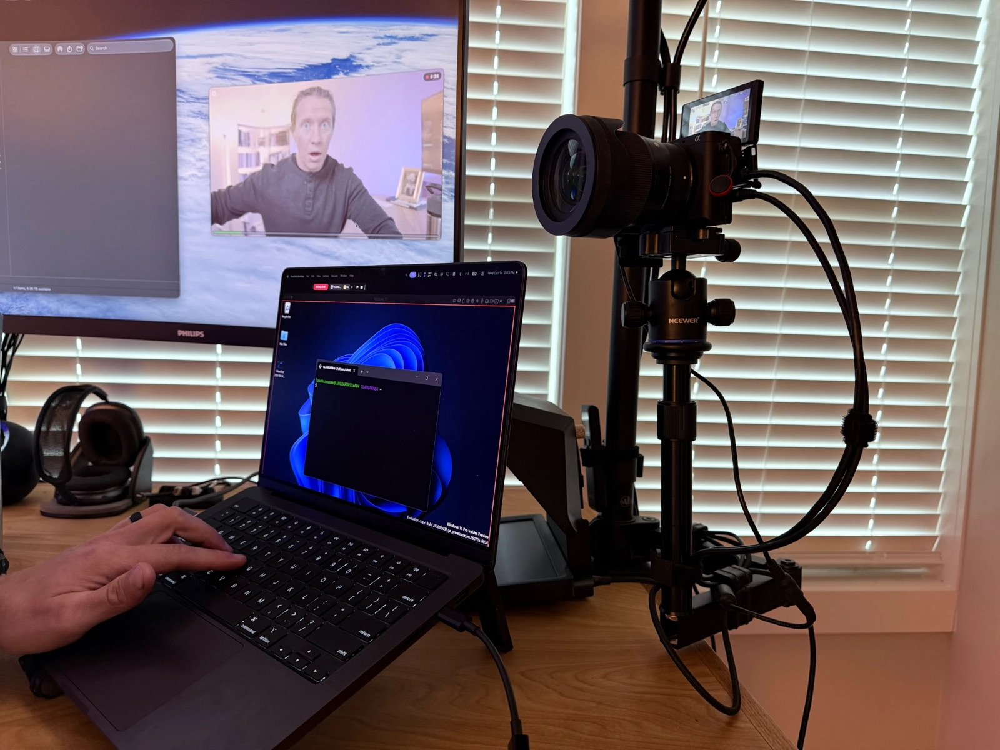
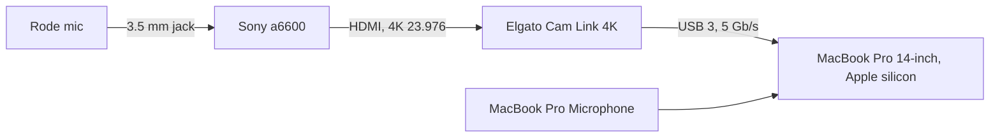

# Setup

This page covers the hardware and the macOS settings that TwinTake needs. For the features, see [guide.md](guide.md).

- [The tested setup](#the-tested-setup)
- [Camera HDMI output](#camera-hdmi-output)
- [Capture card on USB 3](#capture-card-on-usb-3)
- [HDMI splitters and EDID](#hdmi-splitters-and-edid)
- [Frame position](#frame-position)
- [Display refresh rate](#display-refresh-rate)
- [Mac settings](#mac-settings)
- [Permissions](#permissions)
- [Signing (for builders)](#signing-for-builders)

## The tested setup

TwinTake was built and tested on one desk:

- **camera.mov** gets the a6600 picture and the Rode sound, through the Cam Link.
- **screen.mov** gets the laptop display, the MacBook Pro Microphone (a backup and sync track) and the computer sound.

Other cameras and capture cards can work, but they are not tested. Some of the app's messages name this setup: they say "a6600" for the camera and "Rode" for the external mic.

## Camera HDMI output

camera.mov records exactly what the camera sends over HDMI. TwinTake has no size or rate setting, so you set them on the camera.

- **Send 4K.** Set the camera's HDMI output to 3840×2160. If the capture card gets less, the Signal line in the menu turns orange.
- **Send the rate you edit in.** 23.976 fps is the tested rate. Sony cameras in NTSC mode call it "24p". The screen rate follows the camera: 47.952 fps for 23.976, and 59.94 fps for 29.97.
- **Send a clean picture.** Turn off the camera's info overlays on HDMI, or they are in camera.mov.
- **Keep the camera on.** Set a long auto power off, a high temperature limit, and USB power if the camera has it.
- **Change the signal only while nothing records.** camera.mov keeps the size and the rate it started with.

When it works, the Signal line reads "4K · 3840×2160 · 23.976 fps".

### Worked example: Sony a6600 at 4K 23.976

| Setting | Value |
|---|---|
| Mode dial | Movie |
| NTSC/PAL Selector | NTSC |
| File Format | XAVC S 4K |
| Record Setting | 24p 100M |
| HDMI Resolution | Auto (or 2160p/1080p) |
| 4K Output Select | HDMI Only, or Memory Card+HDMI for a backup on the SD card (needs Proxy Recording Off) |
| HDMI Info. Display | Off |
| TC Output | Off |
| Auto Power OFF Temp. | High |
| USB Power Supply | On |

Test Eye AF after you set this up. Sony limits some face and eye AF features with 4K HDMI output.

For the a6600, plug the external mic into the camera's MIC jack. The camera then sends the mic over HDMI, and camera.mov records it.

## Capture card on USB 3

The Cam Link 4K sends uncompressed video, so it needs a USB 3 link (5 Gb/s or more).

- Plug the capture card into a USB 3 port. A USB 2 port, hub, cable or adapter can drop the link to USB 2.
- After an HDMI change, the Cam Link 4K once came back on its USB 2 lane. It still offered 4K but sent empty frames (a solid green picture). TwinTake detects this: a red banner says "Cam Link is connected at USB 2 speed." and Start is blocked. Unplug the Cam Link and plug it back in. See [troubleshooting.md](troubleshooting.md#the-preview-is-green-or-empty).
- To check the link, open events.jsonl of a take. TwinTake logs a `usb_link` event at each Start, for example `"usb":"3"` and `"speed_mbps":"5000"`.

TwinTake treats a camera as a capture card when its name contains "Cam Link", "Elgato", "HDMI" or "Capture". It flags an Elgato capture card on USB 2 with any signal (1080p too). It flags another capture card on USB 2 only with a 4K signal.

## HDMI splitters and EDID

This section is general HDMI background. TwinTake does not check splitters. It only sees the signal that reaches the capture card.

A camera picks its HDMI output format from the device at the other end of the cable. That device sends a list of the formats it accepts. This list is the EDID. A 4K capture card sends an EDID that includes 4K.

A splitter sits between the camera and two or more devices, for example the capture card and a monitor. The camera sees only one EDID: the one the splitter sends. Many splitters send an EDID that every output can take. If one output is a 1080p monitor, the camera then sends 1080p to all of them. Some splitters send a fixed 1080p EDID. In both cases the Signal line in TwinTake shows "1080p".

To get 4K through a splitter:

1. Test without the splitter first. Connect the camera straight to the capture card and check the Signal line.
2. Use a splitter that supports 4K at your frame rate on every output.
3. If the splitter has an EDID switch, set it to copy the EDID of the capture card's output, or to a fixed 4K mode.
4. Make sure every device on the splitter accepts 4K.
5. Check the Signal line again after each change.

## Frame position

The 16:9 frame can sit at the bottom or at the top of the display (Screen > Options > **Frame position**).

- **Bottom** (the default on the built-in display): the frame is flush with the bottom edge. The strip between the menu bar and the frame stays free. On the 14" MacBook Pro the frame is 1504×846 pt at y 136, which leaves 103 pt under a 33 pt menu bar. The Parallels toolbar and the control bar fit there.
- **Top** (the default on other displays): the frame sits under the menu bar. The strip below it stays free for a visible Dock.

With the bottom frame, turn on "Automatically hide and show the Dock" (⌥⌘D). A hidden Dock still slides in when the pointer touches the bottom edge, and screen.mov records it then.

TwinTake remembers the frame position for each display.

## Display refresh rate

The screen file has a constant frame rate. For even motion, two screen frames must span a whole number of display refreshes (within 0.5%). If they do not, preflight shows an orange warning with the rate to pick.

| Screen rate | Refresh rates that fit | Refresh rates that do not fit |
|---|---|---|
| 47.952 fps (camera at 23.976) | 120 Hz, 95.9 Hz, 47.95 Hz | 60 Hz |
| 59.94 fps (camera at 29.97) | 60 Hz, 120 Hz | 100 Hz |

- Set the refresh rate in System Settings > Displays > Refresh Rate.
- On the 14" MacBook Pro, keep the display at 120 Hz. At 60 Hz, preflight asks you to set 120 Hz.
- A ProMotion display gets no warning unless its highest rate fails the rule.

## Mac settings

- **Keep the laptop lid open.** Apple silicon MacBooks turn off the built-in mic in hardware when the lid is closed. The Mac mic track then records silence, and preflight warns.
- **Hot corners:** a hot corner at an edge the frame reaches runs when the pointer gets there, and screen.mov records it. An orange warning names the corner. Turn it off in System Settings > Desktop & Dock > Hot Corners, or set a key to hold for it.
- **Video effects:** turn off Center Stage, Portrait, Studio Light, Reactions, Background Replacement and Edge Light in Control Center > Video Effects. They change the camera picture. Preflight blocks Start while one of them applies to the camera, and warns when one is only turned on in Control Center. The menu then shows an **Open Video Effects** button. macOS shows the Video Effects menu only while an app uses the camera, so turn on Live preview first.
- **Mic Mode:** pick Standard in Control Center > Mic Mode. Another mode can process the camera audio, and preflight warns.

## Permissions

TwinTake needs four macOS permissions:

| Permission | For |
|---|---|
| Camera | camera.mov |
| Microphone | all mic tracks |
| Screen Recording | screen.mov and the computer sound |
| Accessibility | snapping windows into the frame |

1. Open the menu. The **Permissions** section opens by itself when a permission is missing.
2. Click **Allow…** next to each permission. If macOS denied one before, click **Open Settings** and turn it on in System Settings > Privacy & Security.
3. After you allow Screen Recording, quit and reopen TwinTake.

Without the microphone permission, the camera preview opens without the meters, and TwinTake does not ask for the permission until you click Allow.

## Signing (for builders)

macOS ties the camera, mic, screen and Accessibility permissions to the app's code signature. If the signature changes with each build, macOS asks for the permissions again after each build.

1. In Xcode, open Settings > Accounts and add your Apple ID.
2. Select the account, then Manage Certificates > + > Apple Development. The certificate is free.
3. Run `scripts/build-app.sh`. It signs with the first "Apple Development" identity in your keychain.

- To use another identity, set `SIGN_IDENTITY`, for example `SIGN_IDENTITY="Apple Development: Your Name (TEAMID)" scripts/build-app.sh`.
- With no identity, the script signs ad hoc and prints a warning. macOS then asks for the permissions again after every build.
- The script builds `build/TwinTake.app` (debug by default, or `scripts/build-app.sh release`). It copies LICENSE and NOTICE.md into the app.
- The app is not sandboxed, because window snapping uses the Accessibility API. It runs with the hardened runtime and the camera and audio input entitlements.

For the checks that need real devices, see [TESTING.md](TESTING.md).
